# Eksploracja danych – Breath, Brain & Body

Raport z eksploracji obu zbiorów (288 plików SNIRF, 77 osób). Wszystko odtwarza się skryptami z [scripts/](../scripts/), opis w [README](../README.md).
Liczby pochodzą z [summary.json](summary.json) i [tables/](tables/).

## Najważniejsze wnioski

1. **Dane są dobrej jakości.** Mediana SCI wynosi 0,98–0,99, a 91% kanałów długich w DOT i 97–99% w supine jest „dobrych”. Brakujących próbek jest średnio poniżej 0,5%.
2. **Tętno odczytujemy z fNIRS bardzo pewnie.** Dwie niezależne metody (widmowa i detekcja uderzeń) zgadzają się z r = 0,96, a mediana wynosi ~68–70 BPM. W zbiorze 141 Hz widać pełny kształt fali tętna.
3. **Oddech jest w sygnale.** Wolny oddech (SPB) prawie podwaja moc pasma 0,1 Hz (z 0,093 do 0,171, p = 5·10⁻¹²). HbO zmienia się w rytmie cyklu: minimum ~2 s po rozpoczęciu wdechu, maksimum ~6 s, czyli w trakcie wydechu. Synchronizacja fazy ma medianę 0,65.
4. **Koniec bezdechu ma wyraźny biomarker.** HbO i HbR rosną przez cały bezdech i mają szczyt dokładnie w momencie wdechu. W tej samej chwili jest skok w akcelerometrze. To najmocniejszy kierunek do rozwiązania otwartego zadania (nieoznaczone końce bezdechów).
5. **Urządzenie ma automatyczne wzmocnienie.** Natężenie nie zależy od odległości źródło–detektor, a pliki nie zawierają informacji o wzmocnieniu (`detectorGain` = 0). Bezwzględne natężenie nie mówi więc wprost o skórze i tkance. Mimo to **stosunek I760/I850 wiąże się z kolorem włosów** (ρ = −0,47, istotne także po kontroli płci i korekcie FDR).
6. **Płeć jest głównym czynnikiem zakłócającym.** Wiele surowych korelacji ze wzrostem, wagą czy czasem bezdechu znika po kontroli płci.
7. **Z cech fNIRS da się przewidzieć:**
   - **płeć** (AUC 0,94),
   - **ciemne vs jasne włosy** (AUC 0,75),
   - **słabo: BMI** (poprawa błędu o 13% względem średniej, tylko na cechach serca).

   **Nie da się przewidzieć:** typu skóry, poziomu aktywności ani wieku (próba ma prawie samych młodych dorosłych).

## 1. Uczestnicy

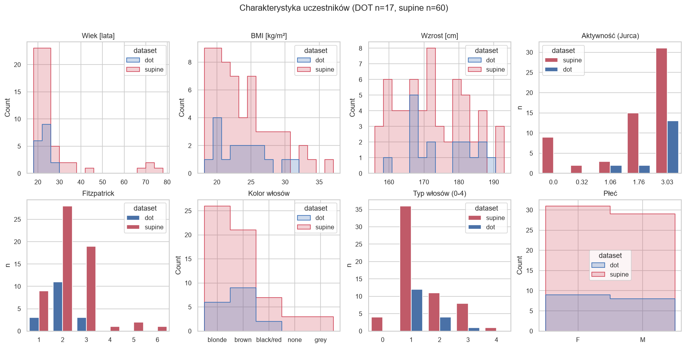

| | DOT (siedząco) | supine (leżąco) |
|---|---|---|
| Osoby | 17 (9 K) | 60 (31 K) |
| Wiek | 23,0 (20–29) | 26,7 (18–78); tylko 4 osoby ≥ 68 lat |
| BMI | 23,6 (18,1–30,9); BMI ≥ 30: 2 osoby | 23,8 (18,5–37,1); BMI 25–30: 14, BMI ≥ 30: 6 |
| Fitzpatrick | I: 3, II: 11, III: 3 | I: 9, II: 28, III: 19, IV–VI: 4 |
| Włosy | brąz 9, blond 6, czarne 2 | blond 26, brąz 21, czarne 7, brak 3, siwe 3 |
| Aktywność 3,03 (najwyższa) | 13 z 17 | 31 z 60 |

**Wnioski dla modeli:** bardzo mało osób z ciemną skórą (IV–VI: 4) i starszych (4). Aktywność jest mocno przesunięta w górę: 76% osób w DOT ma najwyższą kategorię.

CSV wymagały czyszczenia: polski i angielski mieszały się w wartościach, były literówki („straigth”, „brażowe”) i różne zapisy jednostek. Oczyszczone dane są w [subjects.csv](subjects.csv), a kod w [src/hob/subjects.py](../src/hob/subjects.py).

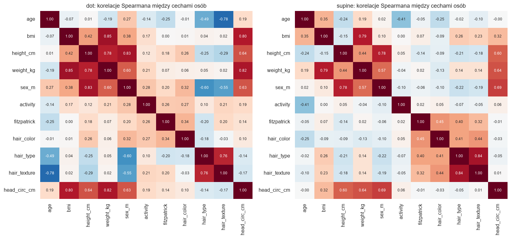

## 2. Inwentarz i jakość sygnału

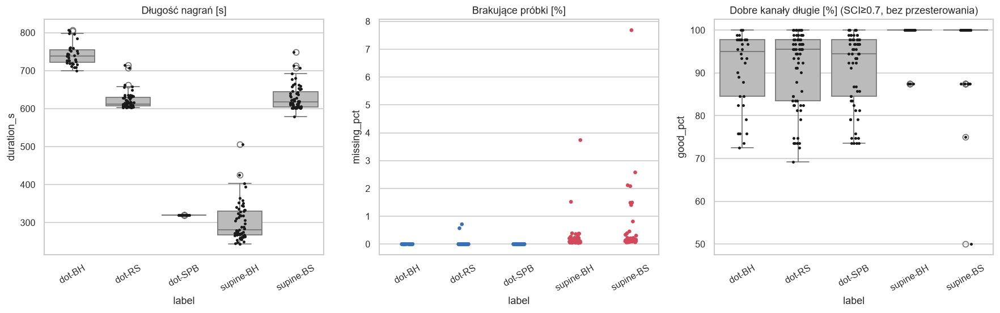

| Zbiór, zadanie | Pliki | Długość [s] | Brakujące próbki | Dobre kanały | fs |
|---|---|---|---|---|---|
| DOT RS | 68 | 602–714 | 0,02% | 91% | 18,27 Hz |
| DOT SPB | 68 | 319,6 | 0% | 91% | 18,27 Hz |
| DOT BH | 34 | 700–806 | 0% | 91% | 18,27 Hz |
| supine BS | 59 | 579–749 | 0,46% | 97% | 141,79 Hz |
| supine BH | 59 | 243–505 | 0,22% | 99% | 141,79 Hz |

„Dobry” kanał oznacza tu SCI ≥ 0,7 i nie więcej niż 20% płaskich próbek.

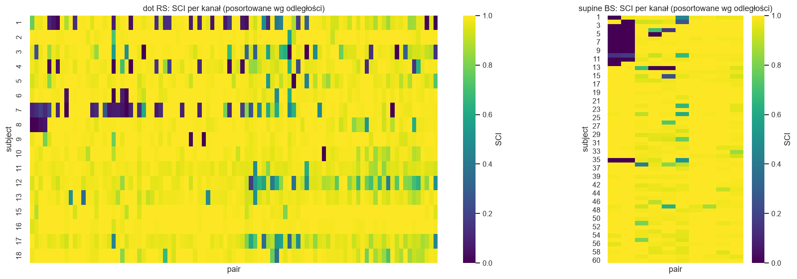

**Optyka i ograniczenia urządzenia:**

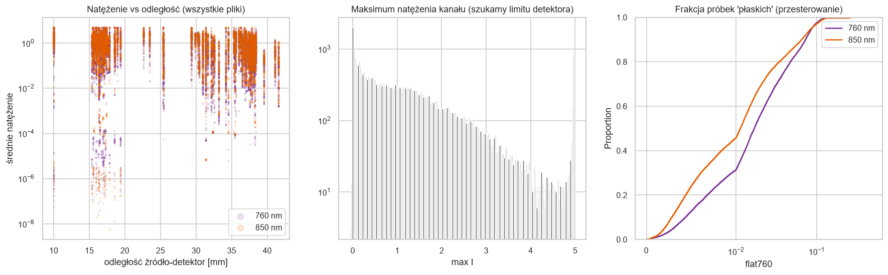

- **Limit detektora wynosi ≈ 4,99** (szczyt na histogramie maksimów). Przesterowanych jest 1,6–1,9% kanałów w DOT, ale **6,4% kanałów 850 nm w supine**. W supine najbardziej dotyczy to **kanałów krótkich S7–D4 i S8–D5 (17% nagrań)**, zgodnie z uwagą w materiałach Cortivision.
- **„Ciemne” kanały** (średnie natężenie ≈ 0 lub ujemne, czyli sam szum) stanowią 7,2% w DOT i występują przy każdej odległości. Najwięcej jest wśród par 10–15 mm (13%).
- **Natężenie nie maleje z odległością,** co wskazuje na automatyczne wzmocnienie per kanał. Wniosek: porównywać **względne** wskaźniki (stosunek długości fal, amplitudę tętna, SCI), a nie bezwzględne natężenie.

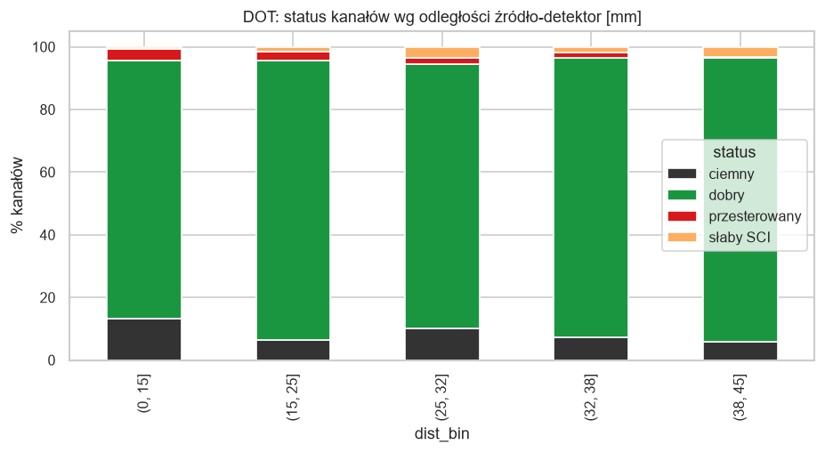

## 3. Co widać w sygnale

Przykładowe nagrania: surowe natężenie, HbO/HbR, pasmo oddechowe, składowa sercowa i akcelerometr.
- DOT SPB: [07_example_dot_SPB.png](figures/07_example_dot_SPB.png)
- DOT BH: [07_example_dot_BH.png](figures/07_example_dot_BH.png)
- supine BH: [07_example_supine_BH.png](figures/07_example_supine_BH.png)
- powiększenia 20 s: `*_zoom.png`

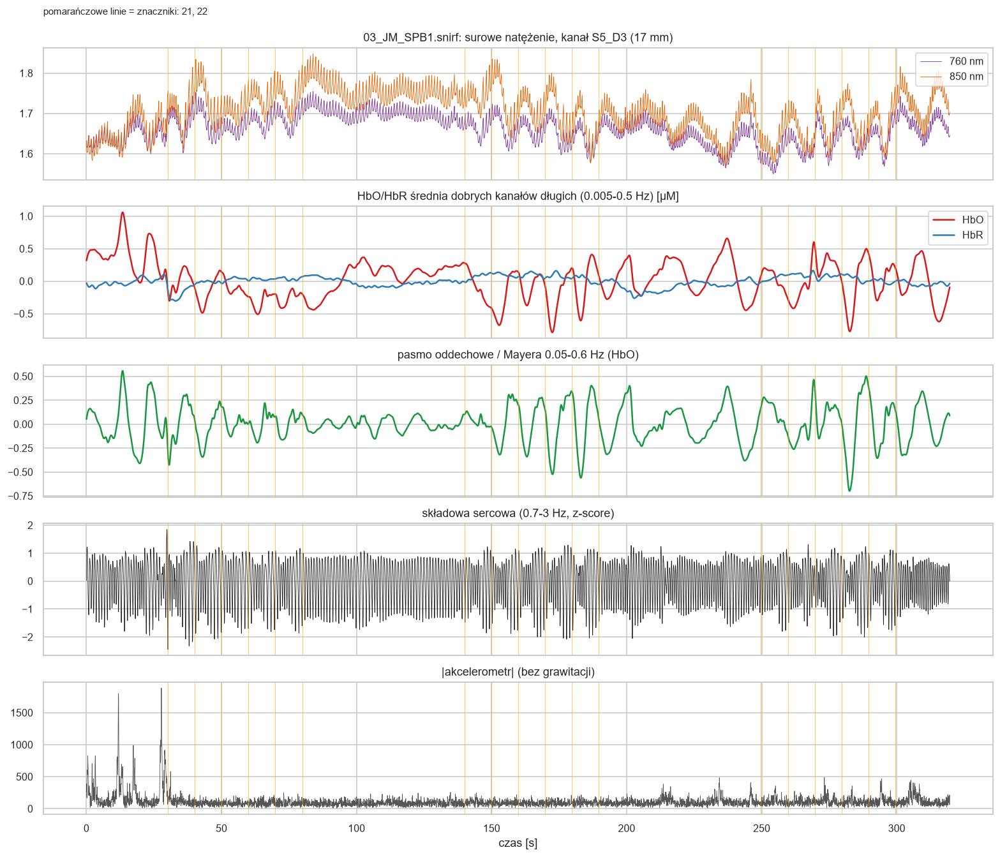

**Widma.** Szczyt sercowy jest przy ~1,1 Hz razem z harmonicznymi. **W SPB wyraźny szczyt jest przy 0,1 Hz.** W widmach uśrednionych po osobach nie widać osobnego szczytu oddechowego, bo każda osoba oddycha w innym tempie.

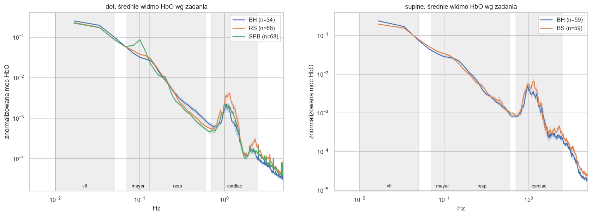
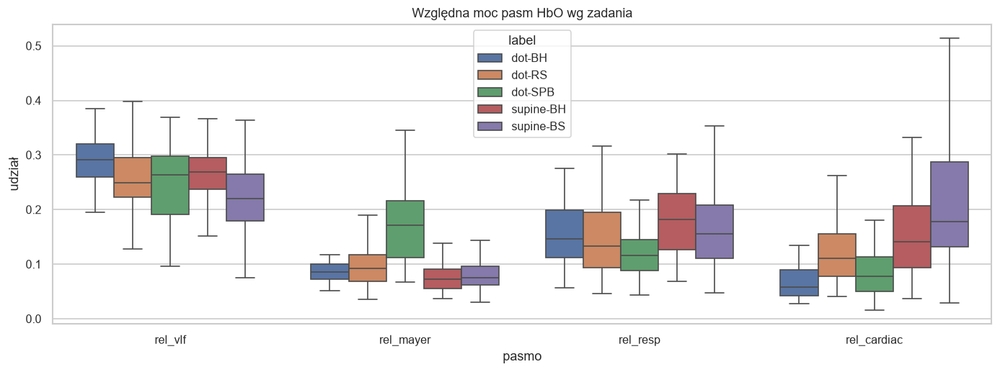

## 4. Oddech: wolny oddech (SPB)

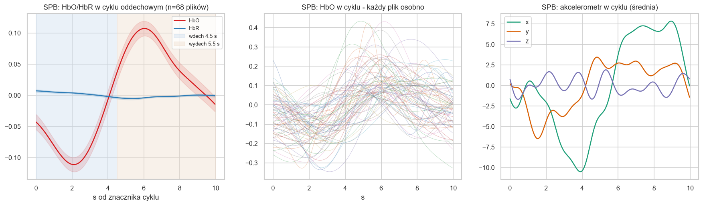

- HbO oscyluje w rytmie zadanego oddechu: minimum ~2 s po rozpoczęciu wdechu, szczyt ~6 s (w trakcie wydechu). HbR prawie się nie zmienia.
- **Akcelerometr (oś x) też pokazuje cykl,** czyli ruch głowy przy oddechu jest mierzalny.
- Dominujący rytm HbO w całym pliku ma medianę 5,55/min, a 54% plików mieści się w 5–7/min. Część pliku SPB to swobodny oddech (przerwy po 60 s, początek i koniec), więc pełny plik nie jest czystym 6/min.

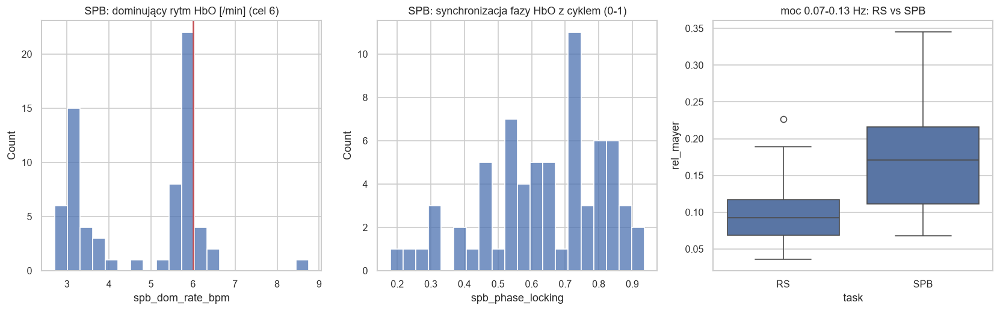

**Ograniczenie:** prosta częstość oddechu z widma działa tylko umiarkowanie.
- **fNIRS:** mediana 9,7/min w RS i 16/min w supine BS. Wartości są wiarygodne, ale nie zgadzają się z akcelerometrem (ρ ≈ 0).
- **Akcelerometr:** metoda widmowa łapie szum (~25–30/min). Uśrednianie względem cykli pokazuje, że sygnał oddechu w nim jest, ale trzeba go wyciągać lepszą metodą, np. PCA osi, dolnoprzepustowy filtr, detekcja szczytów.

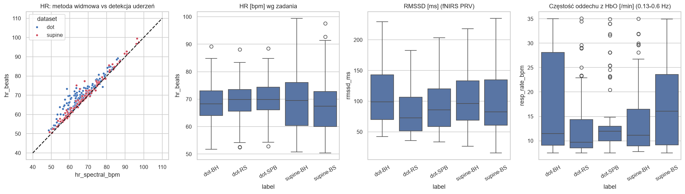
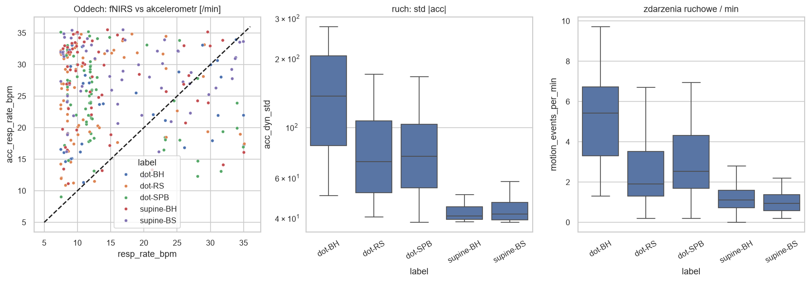

## 5. Bezdech

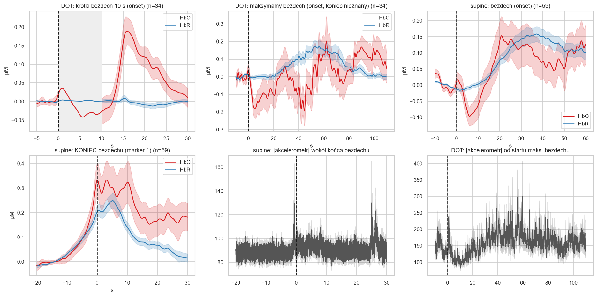

| Pomiar | Wynik |
|---|---|
| supine: czas bezdechu (118 znanych końców) | mediana 21,5 s, zakres 5,3–105,9 s; drugi bezdech zwykle dłuższy od pierwszego |
| supine: odpowiedź HbO na bezdech | mediana szczytu +0,51 µM, ~27 s po starcie |
| **supine: koniec bezdechu** | **HbO i HbR rosną monotonicznie do momentu wdechu; szczyt w t = 0; skok akcelerometru w t = 0** |
| DOT: krótki bezdech 10 s | spadek HbO w trakcie, potem odbicie z szczytem +0,28 µM ~16 s po starcie (6 s po wdechu) |
| DOT: maksymalny bezdech | HbR rośnie przez ~60 s; akcelerometr wyraźnie cichnie przez pierwsze ~25 s (brak ruchów oddechowych), potem ruch wraca |

**Proponowany detektor końca bezdechu:**
- moment, w którym narastanie HbO i HbR załamuje się,
- połączony ze skokiem akcelerometru i powrotem oscylacji oddechowych.

Do treningu i walidacji jest 118 oznaczonych końców w supine. Model można potem zastosować do 59 nieoznaczonych ostatnich bezdechów w supine i 68 maksymalnych bezdechów w DOT.

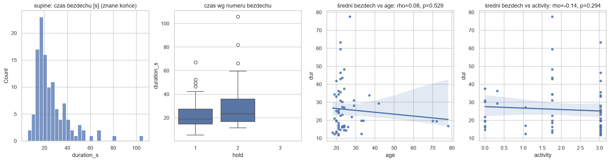

Czas bezdechu nie zależy od wieku ani aktywności. Silnie zależy od płci (ρ = 0,57): mężczyźni wstrzymują oddech dłużej.

## 6. Serce: tętno, HRV, kształt fali

- Tętno z fNIRS jest wiarygodne: dwie metody zgadzają się z r = 0,96.
- **Rytm dobowy (DOT):** tętno w spoczynku wynosi 68,4 → 67,7 → **71,8** → 69,9 BPM w sesjach 1–4 (Friedman p = 0,007). Najwyższe jest ~15:00, po obiedzie. Wtedy też RMSSD jest najniższe. Ruch głowy rośnie z każdą sesją.

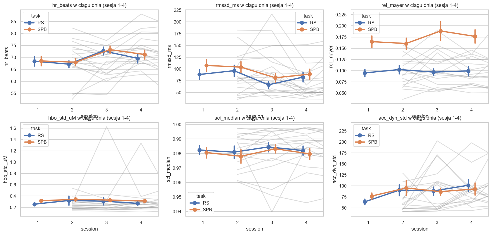

**Fala tętna (supine 141 Hz):**
- czas narastania słabo rośnie z wiekiem (ρ = 0,28; p = 0,035; efekt zależy głównie od 4 starszych osób),
- skośność fali wiąże się z BMI (ρ = 0,45, istotne po FDR i po kontroli płci).

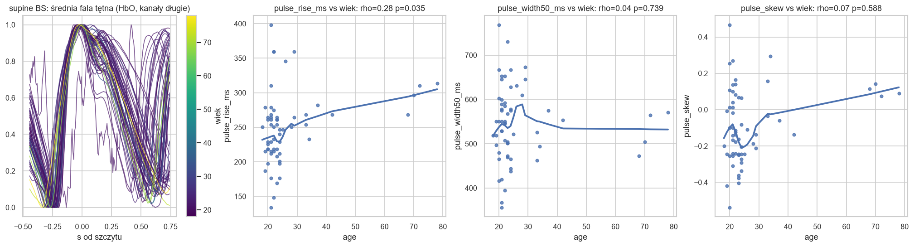

**Wydolność (wzór Jurca) z tętnem z fNIRS:** średnio 13,0 ± 2,6 MET. Tętno spoczynkowe nie koreluje jednak z aktywnością ani z BMI (ρ ≈ −0,12, nieistotne). W tej próbie tętno nie jest więc dobrym wskaźnikiem formy.

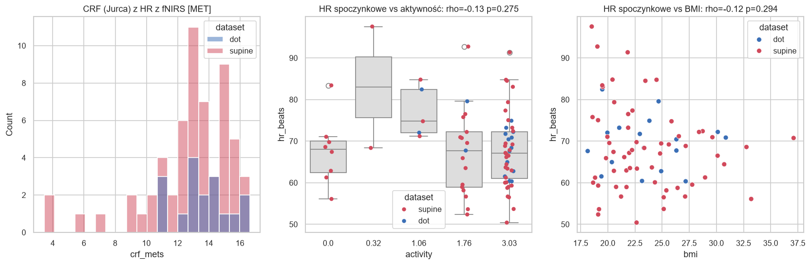

## 7. Korelacje z cechami osób

Wykonano 594 testy Spearmana (cechy fNIRS uśrednione per osoba × cechy osób). 17 z nich przechodzi korektę FDR (q < 0,05), wszystkie w supine. W DOT przy n = 17 nic nie przechodzi.

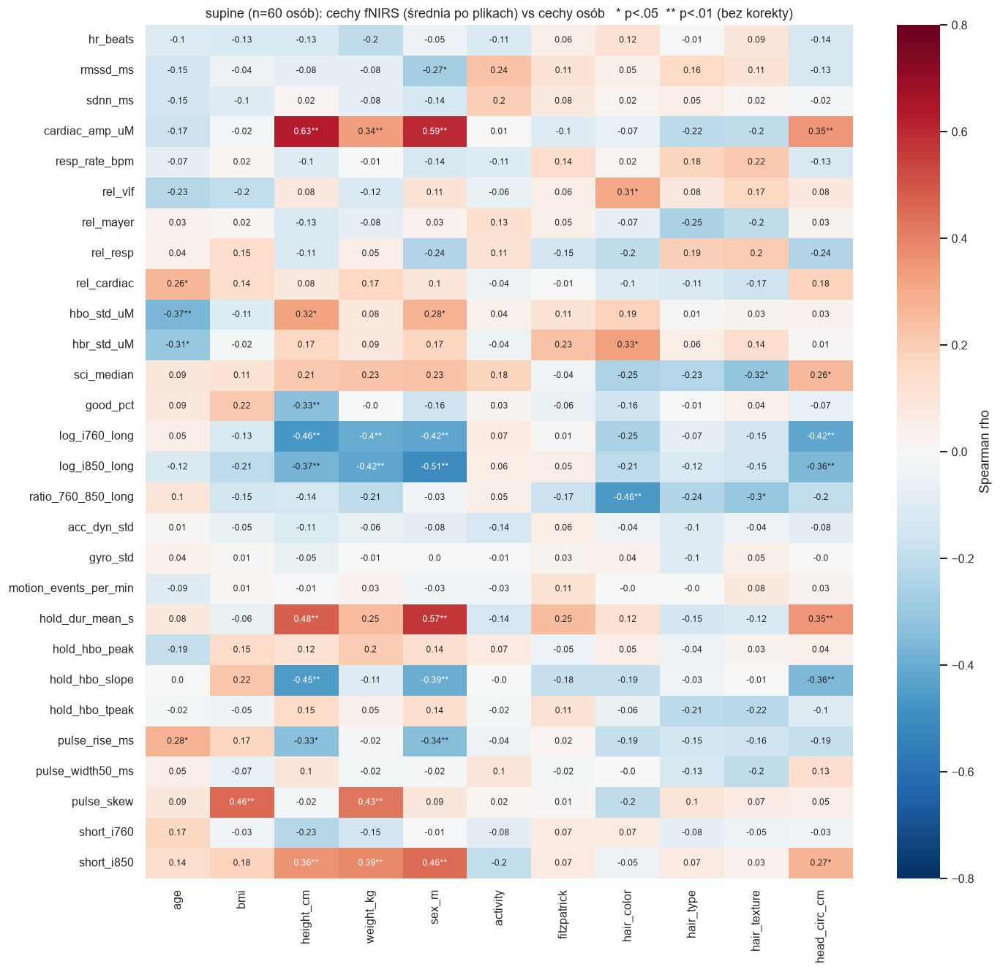

Najsilniejsze surowe efekty, w większości związane z płcią:

| Cecha fNIRS | Cecha osoby | ρ |
|---|---|---|
| amplituda tętna HbO | wzrost / płeć | +0,63 / +0,59 |
| średni czas bezdechu | płeć | +0,57 |
| log I850 | płeć | −0,51 |
| I760/I850 | kolor włosów | −0,46 |
| skośność fali tętna | BMI | +0,46 |

**Po kontroli płci** ([partial_corr_sex.csv](tables/partial_corr_sex.csv)) przetrwały dwa efekty: **I760/I850 a kolor włosów** (−0,47) oraz **skośność fali tętna a BMI** (+0,45), oba z q = 0,027.

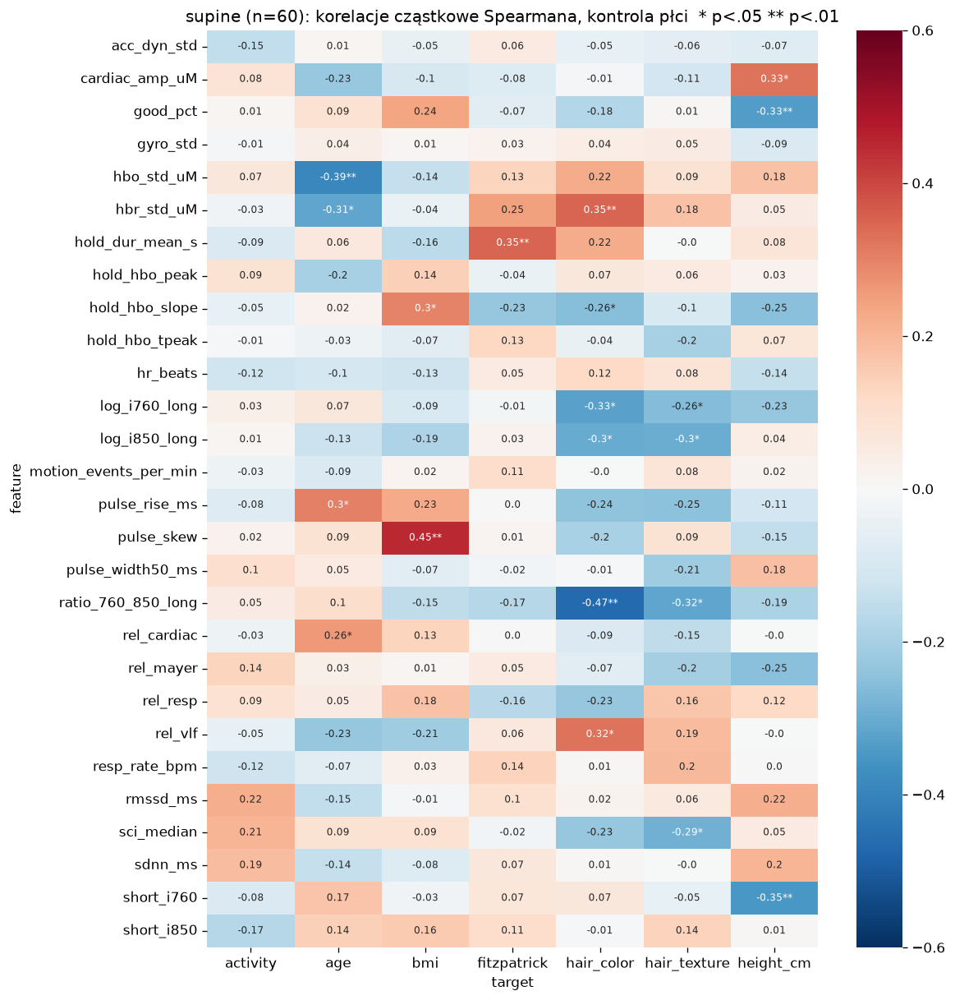
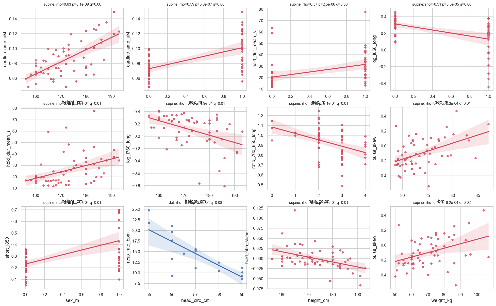
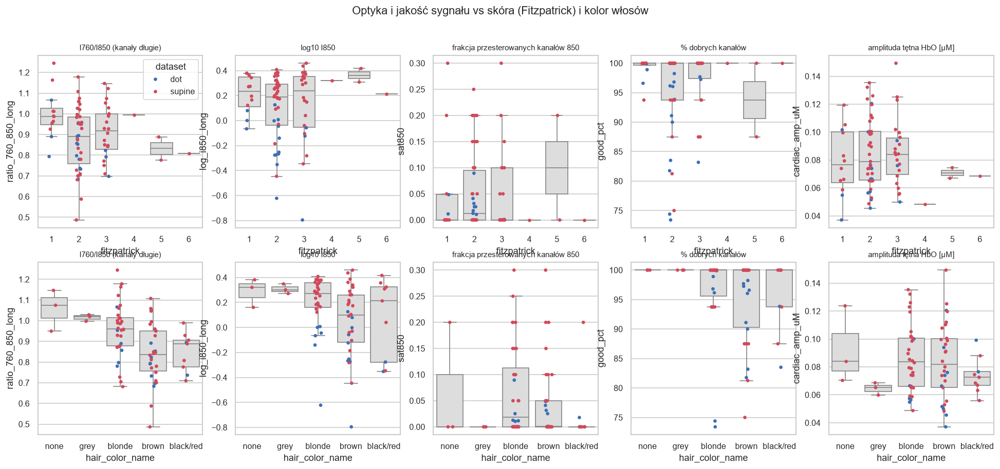

## 8. Czy da się przewidzieć cechy osoby (awatar)?

Model: regresja grzbietowa lub logistyczna, 10-krotna walidacja krzyżowa po osobach, 100 permutacji jako test przypadkowości. Pełne wyniki w [predictability.csv](tables/predictability.csv).

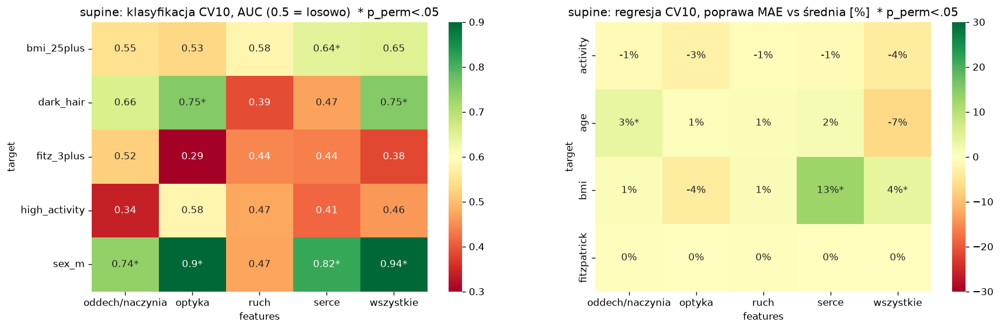

| Cel (supine, n = 60) | Wynik | Czy lepsze od losowego? |
|---|---|---|
| Płeć | AUC 0,94 (optyka: 0,90; serce: 0,82) | **tak** |
| Ciemne vs jasne włosy | AUC 0,75 (optyka) | **tak** |
| BMI | MAE o 13% mniejsze niż przy przewidywaniu średniej (cechy serca) | **tak, słabo** |
| BMI ≥ 25 | AUC 0,64 (serce) | **tak, słabo** |
| Wiek | 3% poprawy | prawie bez znaczenia (mała zmienność wieku) |
| Fitzpatrick (skóra) | AUC 0,29–0,52 | **nie** |
| Aktywność fizyczna | AUC 0,41–0,58 | **nie** |

**Wniosek dla awatara:**
- **kolor włosów** (ciemny/jasny) i **płeć** dają się odczytać,
- **sylwetka** (BMI) tylko orientacyjnie,
- **kolor skóry** i **poziom aktywności** nie (przy tej próbie).

Najmocniejsze, w pełni wiarygodne elementy awatara to **stan ciała w czasie rzeczywistym:** tętno, rytm oddechu i wykrywanie bezdechu.

## 9. Ograniczenia i ostrzeżenia

- **Małe próby:** n = 17 i n = 60, w większości młodzi. Efekty w DOT są niestabilne.
- **Autentykacja:** czepka nie zdejmowano między sesjami, więc model może rozpoznawać założenie czepka, a nie osobę.
- **Częstość oddechu** wymaga lepszej metody niż prosty szczyt widma, szczególnie dla akcelerometru.
- **Uwagi techniczne:**
  - jednostki akcelerometru i żyroskopu nie są opisane (|g| ≈ 150 jednostek),
  - SCI dla kanałów przesterowanych bywa ujemne, takie kanały wykluczamy,
  - DPF zależy od wieku (Scholkmann i Wolf 2013).

## 10. Rekomendowane następne kroki

1. **Detektor końca bezdechu:** trening na supine (118 końców), walidacja z podziałem po osobach, a potem zastosowanie do nieoznaczonych bezdechów.
2. **Oddech na żywo:**
   - faza oddechu z HbO w oknie przesuwnym,
   - walidacja na znacznikach cykli SPB (1020 cykli),
   - fuzja z akcelerometrem (PCA osi).
3. **Tętno i HRV na żywo** do awatara: metoda już działa (r = 0,96).
4. **Moduł jakości sygnału:** przesterowanie, ciemne kanały, SCI, ruch. Można go pokazać jako ostrzeżenie w aplikacji.
